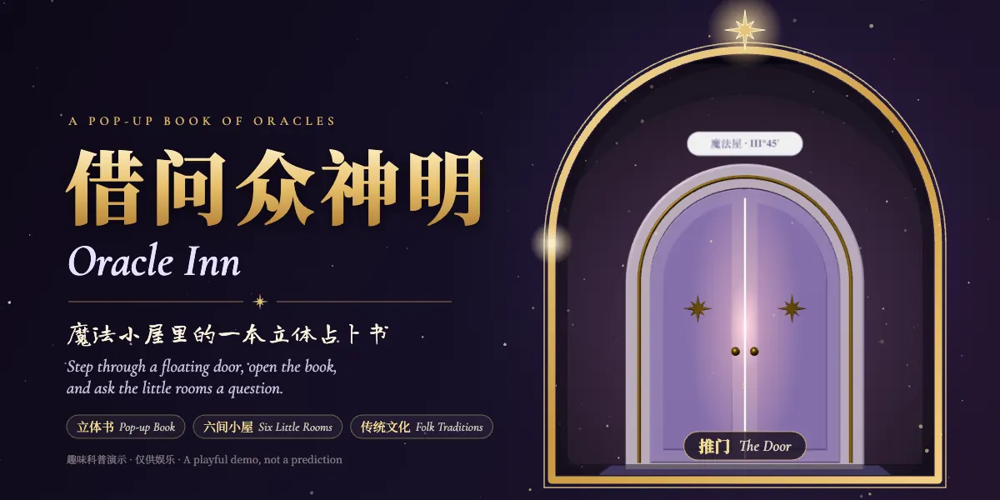

<p align="center">
  
</p>

<p align="center">
  <a href="README.md">中文</a> · <b>English</b> · <a href="https://oracle-inn.summercommences.com">Play it</a>
</p>

# Oracle Inn · 借问众神明

A pop-up book of fortune-telling rooms, in the browser. Step through a door floating in the night sky into a little house full of travel souvenirs, open the book on the desk, and each page raises a tiny oracle room you can walk into and ask a question.

> **A gentle reminder**
>
> - The tarot, moon blocks, fortune slips and the rest are a light-hearted demonstration of Eastern and Western folk customs. Every result is generated at random by the program; nothing here can predict anything.
> - It is for fun only, and is not medical, legal, financial or any other kind of life advice.
> - The shrine, the fortune-slip poems and the cards are original artwork and do not represent any religion, temple or deity.
> - The page collects and sends no personal information.
> - The 人生海海 (People Life, Ocean Wild) neon sign in the house is a fan's tribute to Mayday's album of that name. It is not affiliated with Mayday or their label, and all rights in it stay with their owners.
> - Your path is yours to choose; keep a clear head and decide for yourself. If you are going through a hard time, please reach out to someone you trust or to a professional.

## What's in v1.0

- **The door**: a 3D door that swings open onto a swirling star portal.
- **The Magic House**: things to poke at, including a gramophone playing a waltz, a cat with four moods, the fire, an hourglass, a sunburst mirror, a telescope, a treasure chest and a wishing tree. Each one's little star goes out once you've tried it.
- **The pop-up book**: six spreads; turn the pages and drag to look around.
  - **Page 1 · The Starry Tent** (tarot): swipe to shuffle, cut the deck by hand, then choose a single card, a three-card past–present–future spread or a six-card cross. Cards can come up reversed. The 22 Major Arcana are drawn as cats in a Mucha style, after the compositions of the 1909 public-domain deck.
  - **Page 2 · The Eastern Shrine** (moon blocks and fortune slips): a little temple in the Quanzhou style. Throw the moon blocks, or draw a lot: shake the cup until a stick falls, ask the blocks whether it is yours, then take its poem from the slip cabinet. The sixty poems were written for this book and are attributed to no deity.
  - **Pages 3–6** (the Scholar's Desk, the Victorian Tea Table, the Moonlit Window, the Nordic Hearth): still being bound. Each has a small preview to try: three coins for a line of the I Ching, a Lenormand card, a pendulum and a rune stone.
- Works on phones in portrait.

## Run it locally

The page fetches its 3D scenes, so serve it over HTTP rather than opening the file directly:

```bash
cd public
python3 -m http.server 8000
```

Then open <http://localhost:8000/>. Add `?dev` to the address for a frame counter and the `window.__book` debug hooks.

## Layout

| Path | What's there |
|---|---|
| `public/` | Everything that gets deployed: `index.html`, the deck gallery `cat-tarot-deck.html`, `404.html`, Cloudflare's `_headers`, the site icons (`favicon.*`, `apple-touch-icon.png`, `icon-*.png`, `site.webmanifest`) and the link-preview images (`og-image.jpg` 1200×630, `share-square.jpg` 600×600) |
| `public/tent/`, `public/shrine/` | The two rooms baked in Blender for real-time 3D: glTF description, base64 geometry and two light atlases each |
| `public/deck/` | The 22 card faces and the card back |
| `public/vendor/` | three.js r169 and the web-font subsets, hosted with the site (with their licenses) |
| `src/` | Page source: shell and styles, procedurally painted textures and cards, scenes and interaction |
| `build.py` | Stitches `src/` into `public/index.html`, with the page's script in `public/js/app.<hash>.js` |
| `tools/` | Scripts that fetch three.js (`fetch_three.py`) and the web-font subsets (`fetch_fonts.py`) again |
| `blender/` | Modelling, texture-painting and baking scripts for the tent and the shrine, with their textures and open font subsets |
| `docs/` | The README hero and the social preview image |

## Build

```bash
python3 build.py              # writes public/index.html
python3 build.py --check      # also writes src/.check.mjs for: node --check src/.check.mjs
```

The web fonts hold only the characters the pages use. If `build.py` reports characters missing from the subsets after you change the text, run `python3 tools/fetch_fonts.py` to regenerate `public/vendor/fonts/`, then build again.

## 3D scenes (optional)

Both rooms are modelled from scratch by Blender 5.2 Python scripts and baked in Cycles into two light atlases:

```bash
blender/pipeline_tent_web.sh     # the Starry Tent
blender/pipeline_shrine.sh       # the Eastern Shrine (textures painted first by blender/shrine_tex.py with Pillow)
```

Each run gives its output a new time-stamped name, so browsers never show a stale cached scene. It then updates the names in `src/_rooms.js` and rebuilds the page. Exported JPEGs are stripped of metadata.

## Deploy

`public/` is a plain static site with no build step.

- **Cloudflare Pages**: connect this repository, leave the build command empty, set the output directory to `public`, and add the subdomain under Custom domains.
- **Cloudflare Workers**: `wrangler.jsonc` is included, so `npx wrangler deploy` publishes `public/`.

`public/_headers` sets a Content Security Policy that allows only the site's own files, and lets the versioned scene files, three.js and the fonts be cached for a long time.

## Credits

- [three.js](https://threejs.org/) r169 (MIT), hosted with the site in `public/vendor/three/`.
- Web fonts, all under the SIL Open Font License: Noto Serif SC, Long Cang, LXGW WenKai TC (for the character 筊) and Cormorant Garamond. The subsets come from Google Fonts and are hosted with the site in `public/vendor/fonts/`.
- The shrine's plaque, couplets, slip numbers and scroll titles are set in the open fonts Noto Serif TC and LXGW WenKai TC. The subsets and their licenses are in `blender/fonts/`.
- The tarot compositions and symbols follow the 1909 deck drawn by Pamela Colman Smith (public domain). The images are newly drawn.
- Every texture, card and scene in the page is painted by code or built by Blender scripts. No outside image assets are used.

## Privacy

- No cookies, no analytics. Your questions and readings are never sent anywhere.
- The page makes no third-party requests: three.js and the fonts load from the site itself.
- The "ask the reader" AI reading only works inside a Claude Artifact, where the viewer's own Claude account writes it and nothing is kept. On the open web the button and the question box don't appear.

## License

- Code: [MIT](LICENSE).
- Artwork and writing (cards, scenes, textures, hero images, fortune-slip poems and in-page text): © 2026 SummerPapaya, all rights reserved. See [LICENSE-ASSETS.md](LICENSE-ASSETS.md).

## Versions

- **v1.0.0** (2026-10): first release. The Magic House, all six spreads of the book, the Starry Tent (tarot) and the Eastern Shrine (moon blocks and fortune slips) are fully playable; the other four pages have previews.
